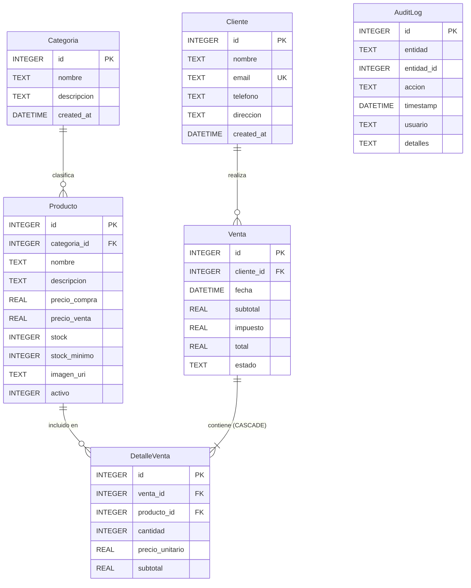

# ComercioPro — CRUD Especializado de Compra y Venta (Expo Go)

Aplicación móvil de alto rendimiento desarrollada en **React Native 0.86**, **Expo SDK 57** y **TypeScript estricto**, diseñada específicamente para ejecutarse en **Expo Go** sin requerir compilaciones nativas personalizadas (*development builds*).

Implementa un sistema comercial completo de **Compra y Venta**, con arquitectura limpia (**Clean Code**, **SOLID**), persistencia relacional local en **SQLite**, animaciones fluidas a 60 fps con **Reanimated 4** y un sistema de diseño visual **Dark-Mode First** de categoría profesional.

---

## 🚀 Características Principales

### 💼 Lógica de Negocio Comercial Real
- **Cálculo Automático de Impuestos:** Liquidación en tiempo real de subtotales, IVA del 19% y totales con animación reactiva de valores.
- **Control de Inventario y Stock en Tiempo Real:**
  - Prevención activa de sobreventa: no permite añadir al carrito ni vender más unidades de las disponibles.
  - Alertas automáticas de stock crítico cuando `stock <= stock_minimo`.
  - Simulador de rentabilidad en creación de productos (compara `precio_venta` vs `precio_compra` y calcula margen porcentual y utilidad neta).
- **Transacciones Atómicas en SQLite:**
  - Emisión de facturas con descuento atómico de stock.
  - **Anulación de Ventas con Reintegro:** Al anular una factura, el sistema devuelve automáticamente el stock de cada producto vendido al inventario dentro de una transacción SQLite (`db.withTransactionSync`).
- **Políticas de Integridad y Eliminación:**
  - **Borrado Lógico de Productos:** Los productos se marcan como inactivos (`activo = 0`) para preservar la integridad histórica de ventas.
  - **Borrado Físico Condicionado de Clientes:** Un cliente **solo** puede eliminarse físicamente si no registra facturas asociadas en el sistema.
- **Trazabilidad y Auditoría:** Registro automático de cada operación `CREATE`, `UPDATE` y `DELETE` en la tabla `AuditLog`.

### 🎨 Diseño Visual Único y Tokens de Marca
- **Dark-Mode First:** Fondo Slate `#0F172A`, superficies elevadas `#1E293B`, bordes translúcidos y acentos vibrantes en Cyan `#22D3EE` y Violeta `#A78BFA`.
- **Modo Claro / Oscuro:** Alternancia fluida con microanimación y persistencia en `AsyncStorage`.
- **Componentes con Identidad Propia:** Tarjetas con curvatura `borderRadius: 20`, sombras con resplandor (*glow effects*), botones degradados con `expo-linear-gradient` y chips translúcidos.

### ⚡ Animaciones y Gestos a 60 FPS
- **Transiciones de pantalla:** Slide horizontal y modales elásticos en Expo Router.
- **Entrada escalonada:** Listas con animación `FadeInDown.delay(index * 45).springify()`.
- **Deslizamiento para eliminar (Swipe-to-delete):** Implementado con `Gesture.Pan()` de `react-native-gesture-handler`.
- **Microinteracciones y Efectos:** Efectos de resorte (*spring scale*) al presionar tarjetas y botones.
- **Feedback Táctil:** Uso de `expo-haptics` (`impactAsync` en pulsaciones y `notificationAsync` en confirmaciones de éxito y advertencias).
- **Esqueletos de Carga Shimmer:** Animación continua de brillo durante la carga de consultas SQLite.

---

## 🛠️ Stack Tecnológico Oficial (SDK 57)

| Herramienta | Versión / Rol |
| :--- | :--- |
| **Expo SDK** | `~57.0.30` (Compatible 100% con la versión actual de Expo Go) |
| **React Native** | `0.86.3` |
| **React** | `19.2.3` |
| **Lenguaje** | **TypeScript** (`strict: true`) |
| **Navegación** | **Expo Router** `~57.0.28` (File-based routing) |
| **Base de Datos** | **expo-sqlite** `~57.0.4` (API moderna síncrona con PRAGMA foreign_keys) |
| **Animaciones** | **react-native-reanimated** `4.5.1` |
| **Gestos** | **react-native-gesture-handler** `~2.32.0` |
| **Estado Global** | **Zustand** `^5.0.15` (Tema y Carrito/Asistente de venta reactivo) |
| **Formularios & Validación**| **react-hook-form** `^7.90.0` + **Zod** `^3.23.8` |
| **Feedback Háptico** | **expo-haptics** `~57.0.3` |
| **Degradados** | **expo-linear-gradient** `~57.0.2` |

---

## 📁 Estructura del Proyecto

```
c:\Users\USER\Documents\Proyecto ExpoGo\
├── app/                           # Enrutamiento basado en archivos (Expo Router)
│   ├── _layout.tsx                # Root layout, SQLite init, Theme & Gesture Handler
│   ├── (tabs)/                    # Navegación por pestañas
│   │   ├── _layout.tsx            # TabBar personalizada con indicadores animados
│   │   ├── index.tsx              # Dashboard comercial (métricas, stock crítico, ventas recientes)
│   │   ├── productos.tsx          # Catálogo con chips de categoría, búsqueda y swipe-delete
│   │   └── ventas.tsx             # Historial de ventas con filtros de estado y skeleton
│   ├── producto/
│   │   ├── [id].tsx               # Ficha técnica, rentabilidad, auditoría y acciones
│   │   └── nuevo.tsx              # Formulario Zod con simulador de rentabilidad en vivo
│   ├── venta/
│   │   ├── nueva.tsx              # Asistente multipaso de facturación (Cliente -> Carrito -> Totales)
│   │   └── [id].tsx               # Factura detallada, cobro y anulación con reintegro
│   └── cliente/
│       ├── index.tsx              # Cartera de clientes y estadísticas de consumo
│       └── nuevo.tsx              # Formulario modal de cliente con validaciones
├── src/
│   ├── components/                # Componentes atómicos reutilizables
│   │   ├── Header.tsx             # Cabecera con selector de tema animado
│   │   ├── GlassCard.tsx          # Tarjeta con borderRadius: 20 y escala con spring
│   │   ├── GradientButton.tsx     # Botón con LinearGradient y estado de carga
│   │   ├── AnimatedBadge.tsx      # Badges para estados de venta e inventario
│   │   ├── AnimatedCounter.tsx    # Contador con pulso numérico reactivo
│   │   ├── CategoryChip.tsx       # Chip interactivo para filtros
│   │   ├── ProductCard.tsx        # Tarjeta de producto con margen comercial
│   │   ├── SaleCard.tsx           # Tarjeta de factura con estado
│   │   ├── SwipeableRow.tsx       # Fila deslizable con gesto Pan
│   │   ├── SuccessModal.tsx       # Modal de éxito con checkmark animado
│   │   ├── ConfirmModal.tsx       # Modal de confirmación con advertencia háptica
│   │   ├── SearchBar.tsx          # Barra de búsqueda con foco reactivo
│   │   ├── MetricCard.tsx         # Tarjeta de métricas para el Dashboard
│   │   ├── FloatingActionButton.tsx # Botón de acción flotante (FAB)
│   │   └── Skeleton.tsx           # Cargador con efecto Shimmer
│   ├── db/                        # Capa de datos SQLite
│   │   ├── database.ts            # Singleton de conexión con claves foráneas activas
│   │   ├── migrations.ts          # Migraciones DDL (Tablas e índices)
│   │   ├── seeds.ts               # Semillas con productos, clientes y ventas de demostración
│   │   └── index.ts               # Inicializador de la base de datos
│   ├── hooks/                     # Custom Hooks para UI limpia
│   │   ├── useTheme.ts            # Consumo de tokens de diseño y modo oscuro
│   │   ├── useProductos.ts        # Operaciones y filtros de inventario
│   │   ├── useVentas.ts           # Gestión de facturas y anulaciones
│   │   ├── useClientes.ts         # Cartera de clientes y comprobaciones de borrado
│   │   └── useDashboard.ts        # Métricas agregadas y resúmenes en tiempo real
│   ├── schemas/                   # Esquemas de validación Zod
│   │   ├── productoSchema.ts      # Validación precio_venta > precio_compra, stock >= 0
│   │   ├── clienteSchema.ts       # Validación de email único y teléfono
│   │   └── ventaSchema.ts         # Validación de carrito y cantidades
│   ├── services/                  # Servicios de negocio (Clean Architecture)
│   │   ├── ProductoService.ts     # CRUD, borrado lógico y control de stock
│   │   ├── VentaService.ts        # Transacción atómica de facturación y anulación
│   │   ├── ClienteService.ts      # CRUD y regla de borrado con comprobación de ventas
│   │   ├── CategoriaService.ts    # Listado de categorías
│   │   └── AuditService.ts        # Registro y consulta de auditoría
│   ├── store/                     # Stores Zustand
│   │   ├── themeStore.ts          # Preferencias de tema persistentes en AsyncStorage
│   │   └── saleWizardStore.ts     # Estado reactivo del flujo multipaso de venta
│   ├── theme/                     # Tokens de diseño (Paleta, tipografía, radios, sombras)
│   │   └── tokens.ts
│   ├── types/                     # Tipado TypeScript del dominio
│   │   └── index.ts
│   └── utils/                     # Utilidades
│       ├── calculations.ts        # Cálculo de IVA (19%) y márgenes de ganancia
│       └── formatters.ts          # Formato de moneda COP/USD y fechas en español
├── app.json                       # Configuración de Expo Go y plugins
├── babel.config.js                # Preset de Babel con plugin de Reanimated
├── package.json                   # Dependencias fijadas y scripts
└── tsconfig.json                  # TypeScript estricto
```

---

## 🗄️ Modelo Relacional de Datos (SQLite)



---

## 🚦 Instrucciones de Ejecución en Expo Go

### 1. Iniciar el Servidor de Desarrollo
Ejecuta en la terminal del proyecto:
```bash
npx expo start
```
*O con limpieza de caché si se requiere:*
```bash
npx expo start -c
```

### 2. Abrir en tu Dispositivo Móvil
1. Abre la aplicación **Expo Go** en tu dispositivo Android o iOS (descargable desde Google Play Store o App Store).
2. Escanea el código QR que se visualiza en la terminal o navegador Metro.
3. La aplicación se compilará instantáneamente con soporte de recarga en caliente (*Fast Refresh*).

### 3. Datos de Demostración Iniciales
Al ejecutarse por primera vez, el sistema siembra automáticamente (*seeds*):
- 4 Categorías comerciales.
- 8 Productos con precios de compra, venta y niveles de stock variados (incluyendo alertas de stock crítico).
- 4 Clientes de ejemplo con información de contacto.
- Facturas históricas y registros de auditoría de ejemplo.

---

## 🛡️ Buenas Prácticas Aplicadas
- **Separación de responsabilidades:** presentación (`app/`), servicios de dominio (`src/services/`), persistencia (`src/db/`) y validación (`src/schemas/`) viven en capas independientes.
- **Validación de datos:** ningún dato inválido entra al sistema gracias a Zod + React Hook Form.
- **Integridad transaccional:** las operaciones críticas (emitir/anular factura) se ejecutan dentro de transacciones atómicas de SQLite.
- **Trazabilidad:** toda operación destructiva queda registrada en `AuditLog` con usuario y motivo.
- **Código limpio y tipado:** TypeScript estricto, funciones atómicas, sin `any` explícitos.
- **Funcionamiento offline:** la app opera sin internet ni servicios externos.
- **IVA del 19%** aplicado conforme a la normativa colombiana vigente.

